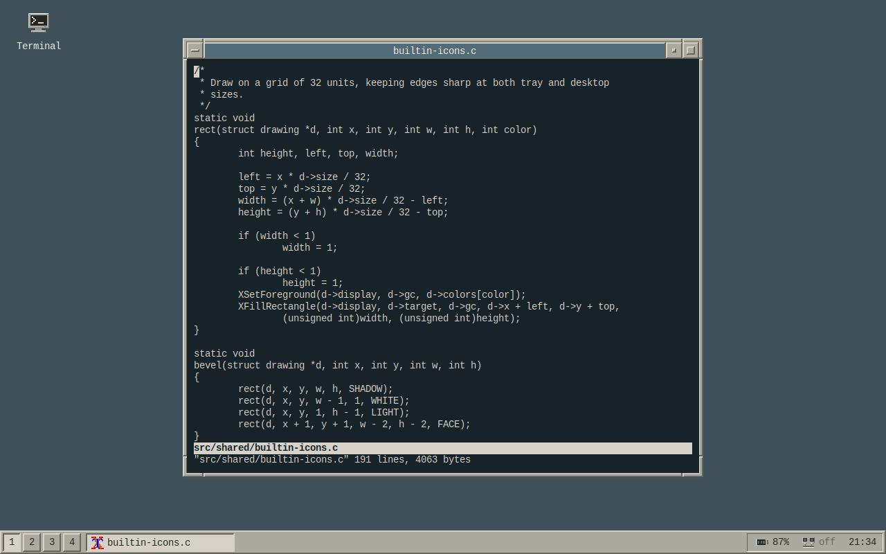

# owm

A small X11 window manager for Linux, written in C with beveled
window frames, a taskbar, virtual desktops, and desktop launchers.



## Build and run

On Debian/Ubuntu:

```sh
sudo apt install build-essential libx11-dev libxft-dev libxpm-dev libpng-dev pkg-config fonts-liberation xfonts-base
make
sudo make install
```

Add `exec owm` to `~/.xinitrc` and run `startx`.

## Configure

Copy [config](config) to `~/.config/owm/config` and edit it to set shortcuts,
launchers, fonts, colors, and tray widgets. The bindings in the shipped
config are also compiled into owm as its default shortcuts. Your config can
override individual bindings. Use `none` to disable a shortcut, or
`clear_bindings = true` to replace the entire set. 

## Contributing

See [CONTRIBUTING.md](CONTRIBUTING.md) for coding and test conventions.
